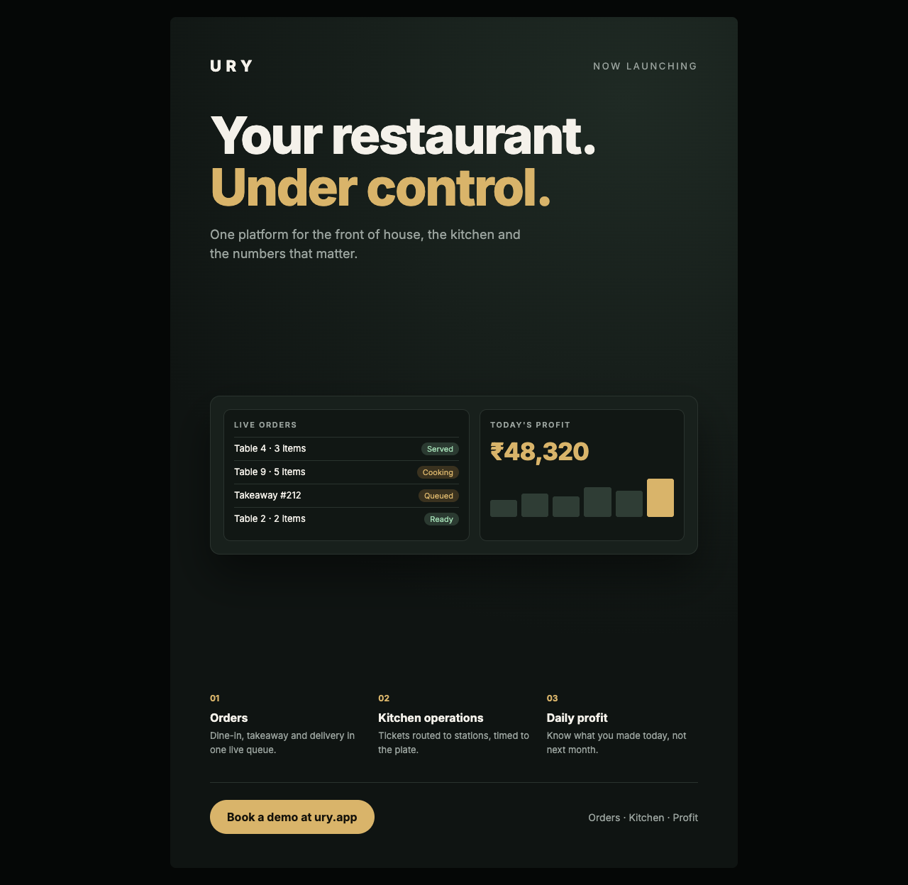
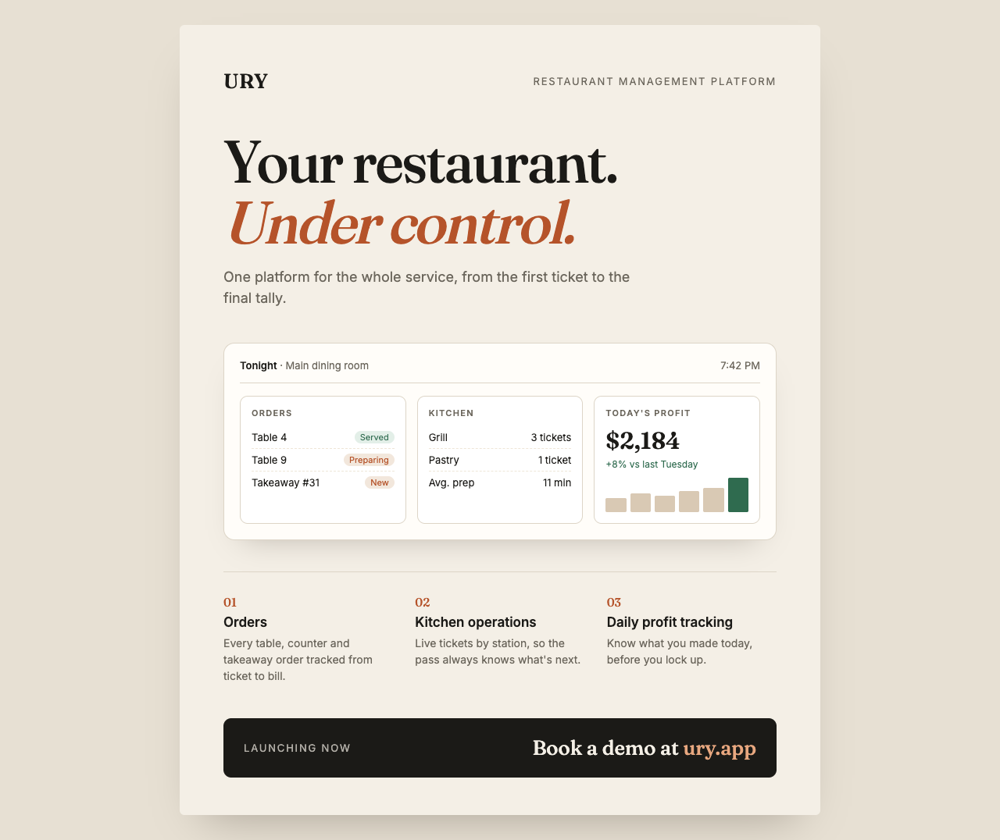
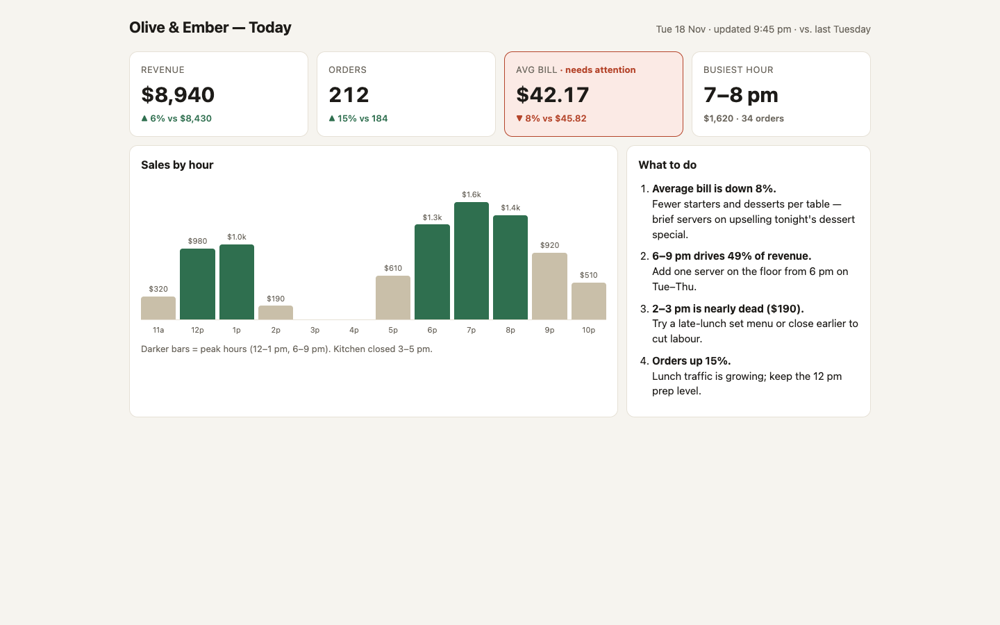
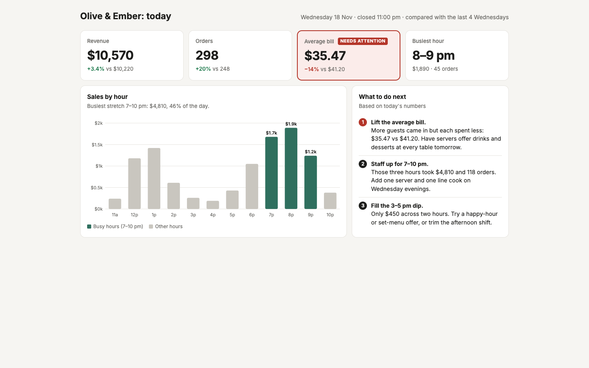
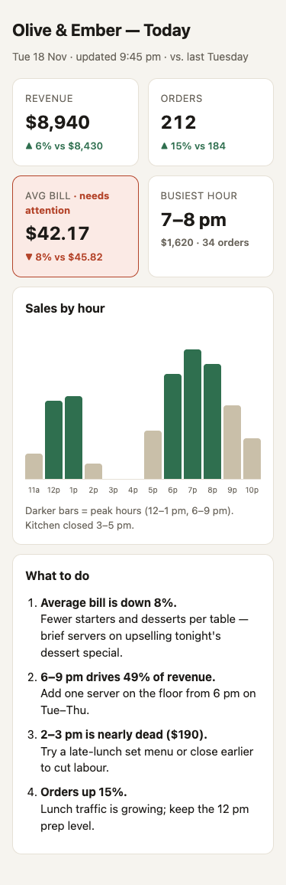
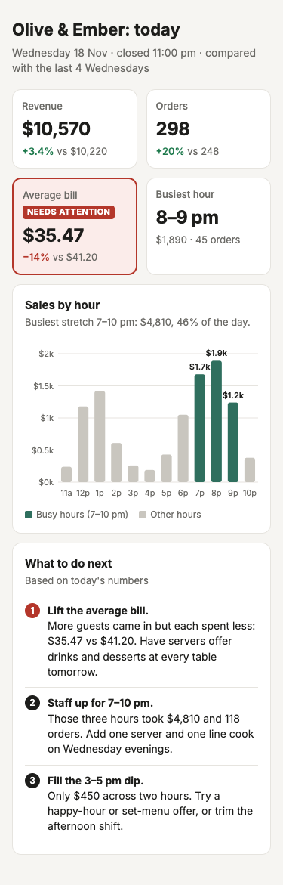

# Twotwo

**Two reviews. Two execution passes.**

Twotwo is a model- and agent-agnostic skill for any AI agent that supports `SKILL.md` skills or custom instructions. It turns a rough request into a clear objective, does the work, and then improves the result in a deliberate second pass that checks the output as delivered.

> Understand twice, execute once, improve once.

## Why

Agents usually act on the first reading of a request and stop at the first draft. That causes two common problems:

- **Misread intent:** the agent solves a slightly different problem than the one you asked about.
- **First-draft defects:** a feature missing from the mock-up, numbers that don't reconcile, a caption that contradicts its chart, empty bands in the layout.

Twotwo reviews the request twice before starting, then critiques the result against your original words and fixes what it finds.

## Evidence

Each prompt was run twice in fresh agent sessions on the same model and settings: once as written, once prefixed with `/twotwo`. Both runs got identical instructions apart from the skill. Every result was screenshotted the same way, at desktop width and at phone width. A separate judge then scored each pair **blind**, under random A/B labels, on missing requirements, readability, alignment, visual hierarchy and usefulness, and recalculated every number in the dashboards.

**Blind result: `/twotwo` won 3 of 4.** The pairs below are the ones where the improvement is clear and both versions are worth looking at. The full record, including the loss and the pairs left out, is under [Full evidence](#full-evidence).

### Launch poster

> Create a launch poster for URY, a restaurant management platform. Headline: "Your restaurant. Under control." Highlight three features: orders, kitchen operations, and daily profit tracking. Use a clean, premium design with a simple product visual and "Book a demo at ury.app" as the call to action.

| Without Twotwo | With `/twotwo` |
| --- | --- |
|  |  |
| Large empty bands above and below the mock-up. The product visual leaves out kitchen operations. "Daily profit tracking" is shortened to "Daily profit". | Tight, even spacing. The mock-up has one pane for each feature: orders, kitchen and profit. The feature names match the request exactly, and the call to action is a full-width bar. |

**Blind judge:** 5/5 on every criterion for `/twotwo`; 3–4 for the version without it.

### Restaurant dashboard

> Build a restaurant owner dashboard showing today's revenue, orders, average bill, and busy hours. Use realistic sample data, including one underperforming metric that needs attention. Include an hourly sales chart and a short list of actionable observations. Make it responsive, with a clear layout that an owner can understand in five seconds.

| Without Twotwo | With `/twotwo` |
| --- | --- |
|  |  |
| It looks fine at a glance, but: the header says "Tue 18 Nov" when that date is a Wednesday; it says "updated 9:45 pm" while the chart already includes the 10 pm hour; and the caption's "12–1 pm" peak doesn't match the bars it describes. | Every figure reconciles: the bars add up to revenue, revenue ÷ orders equals the average bill, and the percentages are correct. The caption, legend and advice all use the same 7–10 pm window, and every action carries a figure. |

**Blind judge:** data consistency 5/5 against 3/5. On the phone, the `/twotwo` chart redraws to keep its labels readable.

| Phone, without | Phone, with `/twotwo` |
| --- | --- |
|  |  |

### What the second pass caught

Each `/twotwo` run reports what its second pass changed. From these tests:

- "The logo was running into the tagline on phones, so I stacked them." (URY poster)
- "On the phone the chart labels were too small to read, so the chart now redraws to fit the screen width." (dashboard)
- "I removed a 'FOR 2' label I had added, because you didn't ask for it." (offer poster)
- "I removed two lines I'd made up ('prices exclude VAT' and 'cancel anytime')." (pricing section)

## When to use it

**Good fits:** anything other people will see or rely on, where a wrong detail is costly.

- Posters, landing sections, pricing pages and dashboards: the rendered-output check catches overlaps, empty areas, and labels or captions that contradict what's drawn.
- Anything with numbers: it recalculates totals, averages and percentages, and checks that they agree everywhere they appear.
- Loosely worded requests: the two reviews pin down scope before any work starts.
- Messages, deploys and other actions with outside effects: both passes run on the draft, and the action happens once.

**Skip it for** quick edits, one-line answers and exploratory throwaway work. The extra pass costs time and tokens: in these tests a `/twotwo` run took about 1.5–3× as long as a plain one (roughly 60–90 seconds against 20–45).

## What to expect

- **A short task statement first**, so you can see how it read your request.
- **A finished result**, already improved. It doesn't show you the first draft.
- **A short note on what the second pass changed**, when that's useful.
- **Assumptions and unverified items**, listed instead of glossed over (for example, "the button links to `#` until you send a booking URL").
- **No scope creep.** It removes additions you didn't ask for rather than adding them.

### Limitations

- **It can't fix the medium.** Hand-drawn SVG food illustrations stayed clip-art quality with or without the skill; use real photography for that.
- **It doesn't always beat a good first draft.** For the pricing section, both versions were polished and correct.
- **It can overcorrect.** In one run, a rule about "elements that look clickable" removed the button styling from a poster's call to action. The rule has since been narrowed, and the skill now says a fix must never weaken a stated requirement. The re-run kept the button.
- **Small sample:** one run per prompt per mode. Treat this as strong signal, not proof.

## How it works

| Step | Phase | What happens |
| --- | --- | --- |
| 1 | **First review**: clarify | Identify the intended outcome and scope, resolve ambiguity, and surface implicit requirements without changing your intent. |
| 2 | **Second review**: refine | Look for remaining gaps, conflicts, unclear boundaries and scope creep. Produce a precise task statement. Ask only if missing information would materially change the outcome. |
| 3 | **First pass**: execute | State the task briefly, then produce a complete first result. |
| 4 | **Second pass**: improve | Compare the result with **both** your original request and the task statement. Inspect the output as delivered: render visuals at desktop and phone widths, recompute figures, run code. Fix the weaknesses without weakening any requirement. |

The reviews stay internal. You see the task, the result, and assumptions or unverified items only when they matter.

## Install

Clone the repository into your agent's skills directory:

```bash
git clone https://github.com/esafwan/twotwo.git <your-agent-skills-dir>/twotwo
```

Start a new session and the skill will be available. If your agent doesn't load skills, paste the contents of [`SKILL.md`](SKILL.md) into its instructions or system prompt; the workflow is plain text and works the same way.

## Usage

Invoke it explicitly. Twotwo doesn't trigger on its own.

```text
/twotwo build a pricing section with monthly and yearly plans
```

You can also say "twotwo this" or "think it through, do it, then improve it".

The rendered-output checks work best when the agent has a browser or screenshot tool (Playwright, a browser MCP, or headless Chrome). Without one, it says what it couldn't verify.

## Full evidence

Everything from the test runs is in [`evidence/`](evidence):

| Path | Contents |
| --- | --- |
| [`evidence/runs/`](evidence/runs) | The HTML each run produced, plus each run's reply to the user (`response.md`). |
| [`evidence/shots/`](evidence/shots) | Desktop and phone screenshots of every run. |
| [`evidence/round-2-blind-judgement.md`](evidence/round-2-blind-judgement.md) | The blind judge's scores and defect lists, verbatim, with the answer key. |
| [`evidence/round-1/`](evidence/round-1) | Screenshots from an earlier manual round, made with the first version of the skill. |
| [`evidence/tools/shot.mjs`](evidence/tools/shot.mjs) | The screenshot script (Playwright with Chrome). |

Prompts tested: the event poster, restaurant dashboard, offer poster, launch poster and pricing section. Pairs not featured above: the **event poster**, where the baseline won before the rule fix and the re-run (`runs/event-poster/twotwo-v2`) ties it; the **offer poster**, a `/twotwo` win, but the SVG food isn't real-world usable; and the **pricing section**, where both versions are good.

## Files

| File | Purpose |
| --- | --- |
| [`SKILL.md`](SKILL.md) | The skill definition that the agent loads. |
| `README.md` | This document. |
| [`LICENSE`](LICENSE) | MIT License. |
| [`evidence/`](evidence) | Test runs, screenshots and the blind judgement. |

## License

[MIT](LICENSE) © 2026 Safwan Erooth
